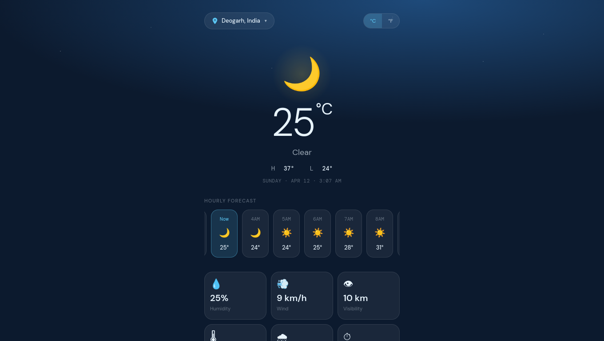

# aero — Weather Dashboard

[](https://opensource.org/licenses/MIT)
[](https://developer.mozilla.org/en-US/docs/Web/JavaScript)
[](https://webpack.js.org/)
[](https://tailwindcss.com/)

> A glassmorphism dark-themed weather dashboard that delivers real-time conditions, hourly forecasts, air quality data, and 7-day outlooks — with dynamic backgrounds and smooth unit toggling.



[Live Demo](https://sid2169.github.io/aero/) • [Report Bug](https://github.com/Sid2169/aero/issues) • [Request Feature](https://github.com/Sid2169/aero/issues)

---

## 📋 Table of Contents

- [Overview](#-overview)
- [Features](#-features)
- [Getting Started](#-getting-started)
- [Usage Guide](#-usage-guide)
- [Technical Implementation](#-technical-implementation)
- [Future Enhancements](#-future-enhancements)
- [Contributing](#-contributing)
- [License](#-license)

---

## 🎯 Overview

**aero** is a browser-based weather dashboard that fetches live data from the WeatherAPI and presents it through a refined glassmorphism UI. It automatically detects your location on load, adapts its background image to the current weather condition and time of day, and gives you everything from AQI to sunrise times in a single scrollable view.

### Why aero?

- **📍 Auto-location**: Uses the browser Geolocation API to fetch weather for your current position without any manual input
- **🌗 Day/Night Awareness**: Background imagery and icons adapt to whether it's currently day or night at the searched location
- **💨 Rich Data**: Goes beyond temperature — AQI with pollutant-level calculation, UV index with colour-coded risk, pressure, visibility, and more
- **🔁 Live Unit Toggle**: Switch between °C and °F instantly with a single click — all values re-render without a network call
- **🔍 Location Search**: Autocomplete search powered by WeatherAPI lets you switch to any city worldwide
- **⚡ Zero Framework**: Pure vanilla JavaScript with Webpack — no React, no Vue, no runtime overhead

---

## ✨ Features

### Current Conditions

- Displays temperature, weather condition text, and a matching SVG icon
- Shows today's high and low alongside the current local time at the searched location
- Background image dynamically maps to the weather condition (sunny, cloudy, rainy, snowy, foggy, thunder) and time of day

### Hourly Forecast

- Horizontally scrollable strip showing all 24 hours of the current day
- Auto-scrolls to the current hour on load
- Each card shows the time, a weather icon, and temperature

### Detail Cards

Nine metric cards arranged in a 3×3 grid:

| Card | Data shown |
|---|---|
| Feels Like | Apparent temperature in selected unit |
| Humidity | Relative humidity % |
| Wind | Wind speed in km/h |
| Visibility | Visibility distance in km |
| Chance of Rain | Daily precipitation probability % |
| UV Index | UV value with animated colour-coded dot indicator |
| Sunrise | Today's sunrise time |
| Sunset | Today's sunset time |
| Pressure | Barometric pressure in inHg |

### Air Quality Index

- Calculates AQI from raw pollutant concentrations (PM2.5, PM10, CO, NO₂, O₃, SO₂) using EPA breakpoint tables
- Displays the computed AQI value, a categorical label (Good → Severe), a description of health implications, and a gradient bar with a live position pointer

### 7-Day Forecast

- Daily cards showing the day name, weather icon, condition text (on larger screens), and high/low temperatures

---

## 🚀 Getting Started

### Prerequisites

- Node.js `>=18`
- npm
- A free [WeatherAPI](https://www.weatherapi.com/) key

### Installation

```bash
# Clone the repository
git clone https://github.com/Sid2169/aero.git
cd aero

# Install dependencies
npm install
```

### Configuration

Create a `.env` file in the project root:

```env
API_KEY=your_weatherapi_key_here
```

This key is read by `dotenv-webpack` at build time and baked into the bundle. It is never sent to any backend — all requests go directly from your browser to WeatherAPI's CDN.

### Development

```bash
npm run dev
```

Opens `http://localhost:3000` with hot reload enabled.

### Production Build

```bash
npm run build
```

Output is written to `dist/`.

### Deploy to GitHub Pages

```bash
npm run publish
```

This builds the project and force-pushes the `dist/` folder to the `gh-pages` branch of your repository.

---

## 📖 Usage Guide

### On first load

aero requests your browser's geolocation. If you allow it, weather for your current coordinates loads automatically. If you deny it, it falls back to Bangalore as the default location.

### Searching for a city

1. Click the location pill in the top-left corner
2. Start typing a city name — autocomplete results appear as you type
3. Click any result to load weather for that location

### Toggling temperature units

Click **°C** or **°F** in the top-right toggle. All temperatures across the hourly strip, detail cards, and 7-day forecast update immediately without a new API call.

---

## 🏗️ Technical Implementation

### Architecture

A vanilla JavaScript single-page application bundled with Webpack 5. No UI framework is used — all DOM construction is imperative JavaScript. PostCSS with Tailwind CSS handles utility classes; custom properties handle the glassmorphism theme.

```
src/
├── index.js                  # Entry point
├── style.css                 # Tailwind directives + custom CSS variables
├── template.html             # HTML shell with sky background layers
├── components/
│   ├── Render.js             # DOM orchestrator — builds shell, refreshes data
│   ├── WeatherApi.js         # Fetch wrappers for forecast and autocomplete
│   ├── WeatherCode.js        # Condition code → icon/text/background mapping
│   ├── WeatherIcon.js        # Condition → emoji mapping for strips
│   ├── Card.js               # Detail metric card components
│   ├── DailyForecast.js      # 7-day forecast row builder
│   ├── Icon.js               # SVG icon pack
│   └── Util.js               # AQI calculation, unit key helpers
└── data/
    └── aqidata.json          # EPA AQI breakpoint table for all pollutants
```

### Key Implementation Details

#### AQI Calculation

Rather than relying on the API's own AQI index, aero computes it independently from raw pollutant concentrations using the EPA linear interpolation formula:

```js
const aqi =
  ((currentRange.aqiRange.high - currentRange.aqiRange.low) /
    (currentRange[pollutant].high - currentRange[pollutant].low)) *
    (pLevel - currentRange[pollutant].low) +
  currentRange.aqiRange.low;
```

The highest sub-index across all measured pollutants becomes the reported AQI.

#### Condition-to-Background Mapping

`WeatherCode.js` maps every WeatherAPI condition code to a named weather category, then `formatBgUrl()` selects the correct ImageKit-hosted background based on the time of day (`is_day`) and viewport width, serving a smaller image on mobile:

```js
const screenWidth = window.innerWidth < 768 ? 'sm' : 'lg';
return BASE_URL + bgUrl[timeOfDay][screenWidth];
```

#### Unit Toggle Without Re-fetching

The active weather data object is held in module scope. Switching units re-renders all DOM nodes using the stored data and the new unit key (`temp_c` vs `temp_f`, etc.) without issuing a new network request.

### Build Pipeline

| Tool | Role |
|---|---|
| Webpack 5 | Bundling, code splitting, asset handling |
| Babel | ES2020+ transpilation |
| PostCSS + Tailwind | Utility CSS generation |
| dotenv-webpack | Inlines `.env` variables at build time |
| HtmlWebpackPlugin | Injects hashed bundle into `template.html` |

---

## 🚧 Future Enhancements

- [ ] **Equity Curve / Temperature Chart**: Line chart of temperature across the hourly or daily forecast
- [ ] **Precipitation Radar Map**: Embed a map tile layer showing rain coverage
- [ ] **Push Notifications**: Alert for rain or UV threshold breaches
- [ ] **Saved Locations**: Persist a list of favourite cities to localStorage
- [ ] **Animated Weather Icons**: Replace static SVGs with Lottie animations
- [ ] **Feels-like Explanation**: Tooltip explaining why apparent temperature differs
- [ ] **Offline Support**: Service worker caching the last successful fetch
- [ ] **Light Theme**: Toggle between the current dark sky theme and a clean light mode

---

## 🤝 Contributing

1. Fork the repository
2. Create a feature branch: `git checkout -b feat/your-feature`
3. Commit your changes using [Conventional Commits](https://www.conventionalcommits.org/)
4. Push and open a Pull Request

Please ensure `npm run build` completes without errors before submitting.

---

## 📄 License

This project is licensed under the **MIT License** — see the [LICENSE](LICENSE) file for details.

---

## ⚠️ Attribution

Weather data is provided by [WeatherAPI.com](https://www.weatherapi.com/). Background imagery is served via [ImageKit](https://imagekit.io/). AQI breakpoint data follows the US EPA standard.

---

<div align="center">

**Built with Webpack · Tailwind CSS · WeatherAPI**

If you found this useful, consider giving it a ⭐

</div>

## Additional Notes

- **responsive layout** — Verify that links and references still resolve.
- **accessibility** — Keep commands copy-pasteable for new contributors.
- **accessibility** — Check the required environment values before deploying.
- **geolocation fallback** — Use the existing project patterns when extending this area.
- **unit toggle** — Document any manual steps that cannot be automated.
- **GitHub Pages deployment** — Check the relevant browser or runtime support.
- **geolocation fallback** — Confirm the expected behavior on a clean checkout.
- **AQI cards** — Verify that links and references still resolve.
- **hourly forecast** — Confirm the expected behavior on a clean checkout.
- **7-day forecast** — Keep commands copy-pasteable for new contributors.
- **hourly forecast** — Keep the terminology consistent with the rest of the project.
- **API limits** — Update the documentation if the visible behavior changes.
- **AQI cards** — Use the existing project patterns when extending this area.
- **hourly forecast** — Verify that links and references still resolve.
- **error states** — Include a short reproduction step when reporting issues.
- **environment configuration** — Document any manual steps that cannot be automated.
- **responsive layout** — Confirm the expected behavior on a clean checkout.
- **browser support** — Verify that changing units does not trigger an unnecessary refetch.
- **WeatherAPI requests** — Check the relevant browser or runtime support.
- **error states** — Add a screenshot or example when it clarifies the workflow.
- **error states** — Verify that links and references still resolve.
- **accessibility** — Check the relevant browser or runtime support.
- **7-day forecast** — Keep the related setup steps aligned with the current scripts.
- **hourly forecast** — Note any external service limits or required keys.
- **caching behavior** — Verify the change in both development and production builds.
- **accessibility** — Confirm the expected behavior on a clean checkout.
- **geolocation fallback** — Keep the terminology consistent with the rest of the project.
- **browser support** — Keep commands copy-pasteable for new contributors.
- **responsive layout** — Document any manual steps that cannot be automated.
- **asset optimization** — Verify that changing units does not trigger an unnecessary refetch.
- **background mapping** — Check the fallback when geolocation permission is denied.
- **accessibility** — Verify that links and references still resolve.
- **responsive layout** — Verify the change in both development and production builds.
- **environment configuration** — Check the relevant browser or runtime support.
- **AQI cards** — Note any external service limits or required keys.
- **error states** — Verify that changing units does not trigger an unnecessary refetch.
- **GitHub Pages deployment** — Verify that links and references still resolve.
- **geolocation fallback** — Update the documentation if the visible behavior changes.
- **browser support** — Check the fallback when geolocation permission is denied.
- **asset optimization** — Check the fallback when geolocation permission is denied.
- **browser support** — Verify the change in both development and production builds.
- **GitHub Pages deployment** — Update the documentation if the visible behavior changes.
- **accessibility** — Use the existing project patterns when extending this area.
